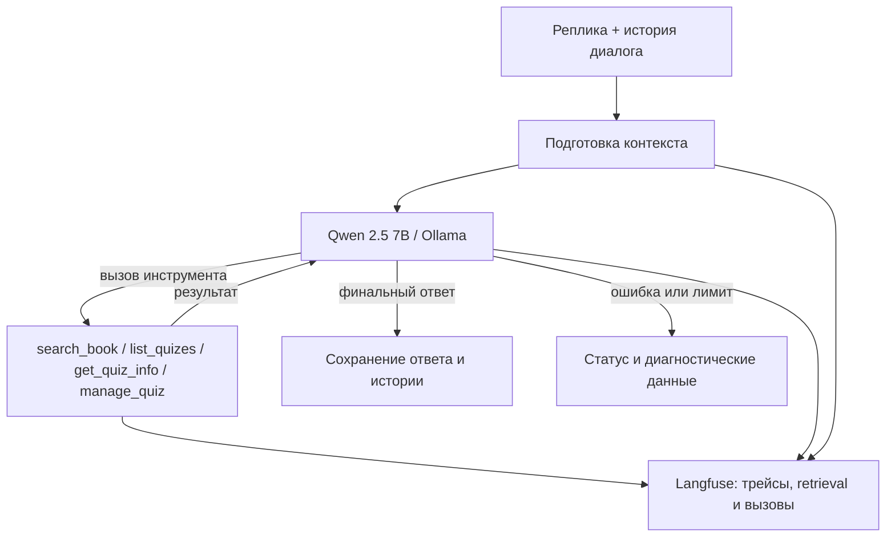

# Лаба 3. Сравнение диалоговых агентов для квизов по Python

**Артём Ковалёв.** Обновлено 6 ноября 2026 года. Одна локальная LLM — `qwen2.5:7b` через Ollama, общий RAG по книге «Укус Питона», одинаковые операции с квизами через инструменты и SQLite. В проекте доступны `custom` (PydanticAI), `smolagents` (ToolCallingAgent) и `coding` (CodeAgent). **Полных оценок CodeAgent в этом отчёте нет.**

> Важно для защиты: после перехода к новой конфигурации **успешность отдельных реплик достигла 46,2% (почти 50%) вместо 28,2%**, однако **успешность целых заданий осталась 22,2% (4/18)**. Это две разные метрики. Сравнение наблюдательное: одновременно с управлением контекстом менялись его бюджет и другие части реализации.

## Результат изменения управления контекстом

Сравниваются два сохранённых прогона `custom` на **одних и тех же 18 заданиях и 39 репликах**, с одинаковыми `input`, `expected_output`, `metadata` и `rubric_version=2`:

- **Исходный:** `20261106T091347Z-f13a68` — [пример трейса](http://localhost:3000/project/lab3/traces/0606481f8a54b75e9893b6203b6769b7).
- **Новый:** `20261106T115324Z-41891f` — [пример трейса](http://localhost:3000/project/lab3/traces/0f68122b67d1c98cf2b9ff00621ac2d0).

| Метрика | До | После | Разница |
|---|---:|---:|---:|
| **Успешные реплики** (внешний судья) | **11/39 = 28,2%** | **18/39 = 46,2%** | **+18,0 п.п.** (+63,6% относительно исходного) |
| **Успешные целые задачи** | **4/18 = 22,2%** | **4/18 = 22,2%** | Без изменений |
| Контекстные реплики (`history_dependent`) | 3/15 = 20,0% | 6/15 = 40,0% | **+20,0 п.п.** |
| Контекстные реплики без флага сокращения | 3/9 = 33,3% | 3/9 = 33,3% | Без изменений |
| Контекстные реплики после сокращения / с флагом `trimmed_before_answer` | 0/6 = 0% | 3/6 = 50,0% | **+50,0 п.п.** |
| Одиночные задачи | 3/9 = 33,3% | 4/9 = 44,4% | +11,1 п.п. |
| Диалоги целиком | 1/9 = 11,1% | 0/9 = 0% | **−11,1 п.п.** |
| Среднее время на задачу | 49,61 с | 82,73 с | **+33,12 с (+66,8%)** |
| Средние входные токены на задачу | 13 454,94 | 17 306,33 | +28,6% |
| Средние выходные токены на задачу | 635,00 | 811,72 | +27,8% |
| Вызовы прикладных инструментов (всего) | 42 | 42 | Без изменений |
| Неудачные вызовы прикладных инструментов | 0 | 3 | +3 |
| Реплики со статусом `error`/`timeout` | 2 ошибки | 2 таймаута | Тип отказа изменился |

**Интерпретация.** Доля правильно выполненных отдельных шагов выросла почти до половины, особенно при работе с историей. При этом критерий полного задания строгий: провал хотя бы одной реплики делает неуспешным весь диалог. В новом прогоне целиком прошли только одиночные задания (`S01`, `S04`, `S05`, `S06`); ни один двух- или шестиходовый диалог не выполнен полностью. Увеличение времени согласуется с большим числом токенов и дополнительными запросами на суммаризацию, но разложить задержку по причинам по одному `report.md` нельзя.

Флаг `trimmed_before_answer` означает, что история была сокращена к моменту ответа; это **не обязательно сокращение именно во время данной реплики**. Нельзя делать вывод о причинном эффекте только по двум группам: их содержание различается.

### Разбивка нового прогона по заданиям

| Группа | Успешные целые задачи | Время на задачу |
|---|---:|---:|
| Лёгкие | 4/6 = 66,7% | 51,96 с |
| Средние | 0/7 | 84,72 с |
| Сложные | 0/5 | 116,86 с |
| Одиночные | 4/9 = 44,4% | 59,48 с |
| Диалоги (все) | 0/9 | 105,97 с |
| Короткие диалоги | 0/6 | 90,68 с |
| Длинные диалоги | 0/3 | 136,56 с |

## Анализ ошибок нового прогона

В `report.md` нового прогона перечислены **14 первых причин провала задачи** (18 задач минус 4 успешные): **8 `judge_rejected`**, **5 `tool_failure`**, **1 `timeout`**. Это категории первых неудачных реплик на уровне задач, а не распределение ошибок всех 39 ходов.

| Категория | Сценарии и наблюдения | Что означает |
|---|---|---|
| **Пропущенные обязательные вызовы** | [S07](http://localhost:3000/project/lab3/traces/8bdeda16542844a21716948aad81493f), [S08](http://localhost:3000/project/lab3/traces/f0daf06cf7b046895786f5b3ec02cb02) — нет успешного `get_quiz_info`; [D01](http://localhost:3000/project/lab3/traces/bf21da25c181c5625238e99dbff191b4), [L01](http://localhost:3000/project/lab3/traces/d022789d8346120ae34fca0a01ffb0aa), [L03](http://localhost:3000/project/lab3/traces/cb7db77f804a82c46ffed7253e162972) — нет `list_quizes` | Агент может получить или помнить сведения, но пропустить явное действие, требуемое задачей. |
| **Неверный ответ/ключ** | [D02](http://localhost:3000/project/lab3/traces/2825e1376db7a64a6c77fb0f7ed1f80b) — `del` назван методом вместо `pop`; [D03](http://localhost:3000/project/lab3/traces/068cad700d2c8a5df9a76264802a8f66) — выбран `return` вместо `max()`; [D05](http://localhost:3000/project/lab3/traces/2cc0f5e5819f617a5e23968b60ab4bb6) — неверная семантика среза `[:]`; [L02](http://localhost:3000/project/lab3/traces/bf7c4fbdb412c6bd008ce9619521bc17) — `pop` вместо `remove` | Создать объект в базе недостаточно: ошибки образовательного содержания делают квиз невалидным по критериям. |
| **Нарушение структуры/темы** | [D03](http://localhost:3000/project/lab3/traces/068cad700d2c8a5df9a76264802a8f66), [D06](http://localhost:3000/project/lab3/traces/cdec1611fc3298c8d9d3df7e50c02849) — 4 варианта вместо 3; [D04](http://localhost:3000/project/lab3/traces/fd2623d2ce99140ac7b558b33e33987f) — вопрос о списках вместо строк | Текущая Pydantic-схема проверяет допустимый диапазон количества вариантов, но не конкретное требование пользователя (например, ровно три). |
| **Некорректные примеры** | [S02](http://localhost:3000/project/lab3/traces/0f68122b67d1c98cf2b9ff00621ac2d0) — невалидный `2things = 10` и вымышленная ссылка; [S03](http://localhost:3000/project/lab3/traces/cdc8e6b991a3fa7e4a3c2ec8abf9ce1c) — пример не демонстрирует заявленную ошибку отступов | Поиск может находить нужную страницу, но генерация примера остаётся некорректной. |
| **Таймаут** | [S09](http://localhost:3000/project/lab3/traces/0b039f05dd24ec31b9b15f0dafdb0264) — после поиска не создан и не прочитан квиз | Лимит 120 секунд критичен для многошаговой задачи с дополнительной нагрузкой. |

**Приоритет улучшений**: (1) гарантировать выполнение явно запрошенных `list_quizes` / `get_quiz_info`; (2) проверять количество вопросов, вариантов, тему и ключи ответа перед подтверждением создания квиза; (3) для примеров Python — синтаксическую и смысловую корректность; (4) отдельно профилировать суммаризацию и задержки. Увеличение окна не заменяет ни одну из этих проверок.

## Текущая схема обработки контекста `custom`

В актуальном `source/agents/custom.py` используется `ObservedCompaction`, наследник штатного `TieredCompaction` из PydanticAI Harness. **Это библиотечные стратегии с собственной обёрткой, а не неизменённый штатный `TieredCompaction`.** Обёртка разделяет историю на завершённые старые ходы и **текущий защищённый ход**, применяет уровни только к старой части и записывает диагностику в Langfuse.

Порядок: `ClearToolResults` (старые результаты инструментов, кроме операций квизов) → `SummarizingCompaction` (резюме старой истории той же LLM; фокус из `prompts/summary_focus.txt`) → `SlidingWindowCompaction` (запасная обрезка) → при крайней необходимости удаление старых целых ходов. Перед запросом модели выполняется `context-check` с подсчётом токенов Qwen, включая системные инструкции и реальные схемы инструментов; событие `context-trim` содержит размер до/после и применённые этапы. История после завершения реплики или ошибки сохраняется через `capture_run_messages` и `repair_messages`.

В актуальном `config.json`: бюджет `context_tokens=17288`, `max_output_tokens=1024`, `context_reserve_tokens=256`, `TURN_RESERVE_TOKENS=2048`; входной бюджет **16 008**, порог сокращения **13 960** токенов. Лимиты: **8 шагов**, **4 вызова инструментов**, **120 секунд** на реплику. Сама по себе суммаризация не гарантирует сохранение `quiz_id`: при потере следует вызывать `list_quizes`, а не придумывать идентификатор.

## Ограничения интерпретации

- В новом прогоне изменилось не только управление контекстом: относительно исходного состояния обновлялись схема, бюджет окна (ранее документировано 12 288, теперь 17 288 токенов), обработка запросов и валидация ответов. Следовательно, корректно говорить об улучшении **наблюдаемой новой конфигурации**, а не о доказанном независимом эффекте `TieredCompaction`.
- Оценка по 18 задачам невелика; варианты модели, стохастика генерации, различия времени исполнения и состояние окружения могут влиять на итог. Абляция с одинаковыми настройками, где меняется только контекстная стратегия, не проводилась.
- Оценки правильности реплик (11/39 и 18/39) получены из двух файлов `external_judge`; `evaluate.py` дополнительно учитывает обязательные инструменты. В представленных полных итогах успех целой задачи составляет 4/18 в обоих прогонах.
- Новый `report.md` не содержит полного набора агрегатов RAG и Tool correctness, поэтому не следует переносить старые значения Recall@5/Precision@5/MRR на новый прогон. Нулевые тарифы локальной Ollama не означают отсутствия вычислительных затрат.
- Трейсы Langfuse в отчёте используют локальные URL, доступные после запуска инфраструктуры лабораторной.

## Пересчёт оценок сохранённых прогонов

```powershell
uv run --locked python source/evaluate.py ".\results\20261106T091347Z-f13a68" --judge-score external_judge
uv run --locked python source/evaluate.py ".\results\20261106T115324Z-41891f" --judge-score external_judge
uv run --locked python source/evaluate.py ".\results\20261106T092905Z-775cec" --judge-score external_judge
```

Результаты старого сравнения `custom` с `smolagents.ToolCallingAgent` сохранены ниже как исторический базовый эксперимент. Режим `coding` существует в коде, но по нему нельзя заключить результат по этому отчёту.

---
## Архив: исходная архитектура и методика (до переработки)



`custom` использует PydanticAI и собственную обработку истории. У него контекстное окно 12 288 токенов: резерв 1 024 на ответ и 256 на погрешность подсчёта, перед новым ходом дополнительно 2 048 на результаты инструментов; порог сокращения истории — 8 960 токенов. Сначала `ClearToolResults` сокращает старые результаты поиска, затем при необходимости удаляются целые старые ходы. Внутри хода выполняется только проверка бюджета, без повторной суммаризации. На реплику заданы максимум 8 шагов модели, 4 вызова инструментов и 120 секунд.

`smolagents` использует штатный цикл и память `ToolCallingAgent`, адаптер Ollama и интеграцию OpenInference/OpenTelemetry. Схемы инструментов в актуальной ветке формируются из аннотаций и docstrings Python-функций; для вложенного типа `Question` в smolagents предусмотрено сохранение Pydantic-схемы и проверок. Оба агента получают одну и ту же ограниченную выдачу RAG (не более 4 000 символов, с PDF-страницами); полные результаты поиска сохраняются в данных эксперимента.

Данные эксперимента: 18 задач и по 39 реплик на агента: 9 одиночных задач, 6 коротких диалогов и 3 длинных диалога по 6 реплик. По сложности: 6 лёгких, 7 средних, 5 сложных. Для контроля истории используются ссылки на ранее созданные квизы и числа, заданные в предыдущих репликах. Метрики RAG вычислены при `k=5` по эталонным PDF-страницам.

Прогоны:
- **custom:** `20261106T091347Z-f13a68` — [результаты в Langfuse](http://localhost:3000/project/lab3/traces/0606481f8a54b75e9893b6203b6769b7) (пример трейса S02).
- **smolagents:** `20261106T092905Z-775cec` — [результаты в Langfuse](http://localhost:3000/project/lab3/traces/e8124d7565d5ee38343f7465921a3fd2) (пример трейса S01).

Источник чисел: `summary.csv` из двух прогонов; примеры ошибок — их `report.md`. Использована импортированная бинарная оценка `external_judge`: 1 только при выполнении всех существенных условий реплики. `evaluate.py` дополнительно требует успешный статус реплики и выполнение обязательных инструментов и действий. **Успех задачи/диалога** означает успешность всех её проверяемых реплик. `Tool correctness` отражает ожидаемые имена инструментов, а не правильность аргументов или содержимого квиза; содержательные ошибки проверяются отдельно.

## Архив: сравнение с ToolCallingAgent на исходной конфигурации

| Метрика | custom | smolagents |
|---|---:|---:|
| Успешные задачи (18) | **4/18 (22,2%)** | **0/18 (0%)** |
| Учёт контекста (контекстные реплики) | 20,0% | 0,0% |
| Контекст до первого сокращения (custom) | 33,3% | — |
| Контекст после первого сокращения (custom) | 0,0% | — |
| Среднее время на задачу | **49,61 с** | 72,85 с |
| Средние входные токены на задачу* | 13 454,94 | 19 548,76 |
| Средние выходные токены на задачу* | 635,00 | 866,88 |
| Стоимость API на задачу** | $0,00 | $0,00 |
| Задачи с ошибкой | 11,1% | 50,0% |
| Задачи с достижением лимита шагов | 0,0% | 5,6% |
| Среднее число шагов на реплику* | 2,23 | 2,85 |
| Среднее число вызовов инструментов на реплику | 1,08 | 1,54 |
| Максимальный оценённый контекст, токенов | 11 536 | — |
| Tool correctness | 61,5% | **74,4%** |
| Recall@5 | 0,50 | **0,62** |
| Precision@5 | 0,35 | **0,41** |
| MRR | 0,82 | **0,96** |

* Для `smolagents` покрытие учёта токенов/стоимости составляет 94,4% задач против 100% у `custom`; средние токены и шаги следует интерпретировать с учётом пропусков. Величины из CSV агрегированы по задачам, а не являются скоростью отдельного запроса модели.

** Стоимость API равна нулю по заданным тарифам локальной модели; затраты на оборудование и электроэнергию не измерялись.

### Разбивка по сложности и типу

| Группа | Число задач | Успех custom | Успех smolagents | Время custom, с | Время smolagents, с |
|---|---:|---:|---:|---:|---:|
| Лёгкие | 6 | 3/6 | 0/6 | 35,32 | 50,83 |
| Средние | 7 | 1/7 | 0/7 | 49,21 | 73,97 |
| Сложные | 5 | 0/5 | 0/5 | 67,30 | 97,72 |
| Одиночные | 9 | 3/9 | 0/9 | 38,84 | 52,49 |
| Диалоги | 9 | 1/9 | 0/9 | 60,37 | 93,21 |
| Короткие диалоги (средние) | 6 | 1/6 | 0/6 | 49,46 | 73,10 |
| Длинные диалоги (сложные) | 3 | 0/3 | 0/3 | 82,21 | 133,44 |

По среднему времени `custom` быстрее на **23,25 с на задачу** (примерно на 31,9% относительно `smolagents`). Разница успешности — **22,2 процентного пункта**. Однако по Tool correctness и RAG-метрикам впереди `smolagents`: успешность конечной операции нельзя подменять фактом вызова нужного инструмента или наличия релевантного поиска.

## Архив: ошибки исходных прогонов

| Агент и сценарий | Категория | Наблюдение |
|---|---|---|
| custom / [S02](http://localhost:3000/project/lab3/traces/0606481f8a54b75e9893b6203b6769b7) | Ошибка ответа | Правило и страница 47 верны, но предложенный Python-пример содержит синтаксически недопустимое присваивание `2things = 10`. |
| custom / [S06](http://localhost:3000/project/lab3/traces/4be4ba82462e2df818266e74d559b716) | Ошибка исполнения | Ошибка модели HTTP 500, требуемый ответ о `global` не получен. |
| custom / [S07](http://localhost:3000/project/lab3/traces/79fda4624a76e7ee36678d93dff888a7) | Инструмент | Пропущено обязательное успешное чтение квиза через `get_quiz_info`. Аналогично S08 и S09. |
| custom / [D02](http://localhost:3000/project/lab3/traces/b7fd9027df1d781bb04106c8f4fe9736) | Состояние квиза | Созданы вопросы с четырьмя вариантами вместо трёх. |
| custom / [L01, ход 2](http://localhost:3000/project/lab3/traces/89f8ed5afa17952b657ff668d136b134) | Содержимое вопроса | Вопрос о длине строки ошибочно отмечает `sum()` вместо `len()`. |
| custom / [L02, ход 1](http://localhost:3000/project/lab3/traces/11ffd8f756467d50e0166ea87d21d7fb) | Контекст | Ссылка верна, но агент не воспроизводит сохранённое число 53. |
| smolagents / [S01](http://localhost:3000/project/lab3/traces/e8124d7565d5ee38343f7465921a3fd2) | Уход от задачи | Вместо объяснения числовых типов выводит проект JSON-квиза; нет требуемого примера и PDF-страницы. |
| smolagents / [S07](http://localhost:3000/project/lab3/traces/123c37ef25261fa62895fc0624a1a12f) | Инструмент | Отсутствует успешный `get_quiz_info`. |
| smolagents / [D01](http://localhost:3000/project/lab3/traces/bfb891cb6640591dc6fc1e41b1de4cca) | Неверная операция | Создан `Python Basics` вместо `Практика 1`, три вопроса вместо двух; предпринята попытка чтения несуществующего ID. |
| smolagents / [D03](http://localhost:3000/project/lab3/traces/928af0ce1db6ebe103449edd72b611bb) | Инструмент | Нет успешного `manage_quiz:create`. |
| smolagents / [L01, ход 1](http://localhost:3000/project/lab3/traces/8b17bed46ba21645a04a5d89f215f075) | Контекст | Агент не воспроизвёл число 37, хотя ссылка на квиз корректна. |
| smolagents / [L02, ход 1](http://localhost:3000/project/lab3/traces/22f641135290ffb5aa9562352238c001) | Контекст | `list_quizes` выполнен, ссылка корректна, но число 53 не воспроизведено. |

В исходном отчёте `smolagents` также отмечены ошибки формата ответов, пропуски создания квизов (S08, S09, D02, D05, D06) и потеря числа 79 в L03. Доля `error_rate=50,0%` не равна доле проваленных заданий (100%): некоторые неверные по критериям ответы завершились с техническим статусом `success`.

## Выводы по исходному эксперименту

1. `custom` успешно завершил 4 из 18 задач и оказался быстрее, несмотря на более низкие `Tool correctness` и оценки поиска. Это подчёркивает необходимость проверки итогового состояния квизов, а не только факта вызова инструмента.
2. `smolagents` чаще использовал ожидаемые инструменты и лучше находил релевантные фрагменты, но ни одна задача целиком не прошла оценку. Наблюдались неправильные операции с квизами, уход от пользовательского вопроса и ошибки памяти.
3. На сложных задачах обе конфигурации показали 0/5 успешных решений. У `custom` после зафиксированного сокращения истории в этой выборке успех контекстных реплик составил 0%; это **не доказывает причинное влияние** сокращения: группы до/после состоят из разных реплик.
4. Проверялись две конкретные конфигурации на одной малой локальной модели. Результат нельзя переносить на все реализации PydanticAI и smolagents. Статистическая значимость не оценивалась; для вывода о причинах нужны повторные прогоны/абляции. Сравнение отражает состояние кода и схем инструментов, с которым выполнены указанные прогоны.
5. Практические улучшения: для `custom` — проверять ограничения задания и правильность содержимого квиза перед подтверждением успеха; для `smolagents` — улучшать формирование структурированных вызовов и соблюдение инструкций. Повторные прогоны после изменения адаптера следует считать **отдельным экспериментом**, не смешивая метрики.

## Воспроизведение исходных оценок

```powershell
uv run --locked python source/evaluate.py ".\results\20261106T091347Z-f13a68" --judge-score external_judge
uv run --locked python source/evaluate.py ".\results\20261106T092905Z-775cec" --judge-score external_judge
```

Оценки `external_judge` должны быть заранее привязаны к соответствующим `trace_id` в Langfuse. Файлы `summary.csv` и `report.md` каждого прогона являются исходной детализацией и не заменяются этим сводным отчётом.
