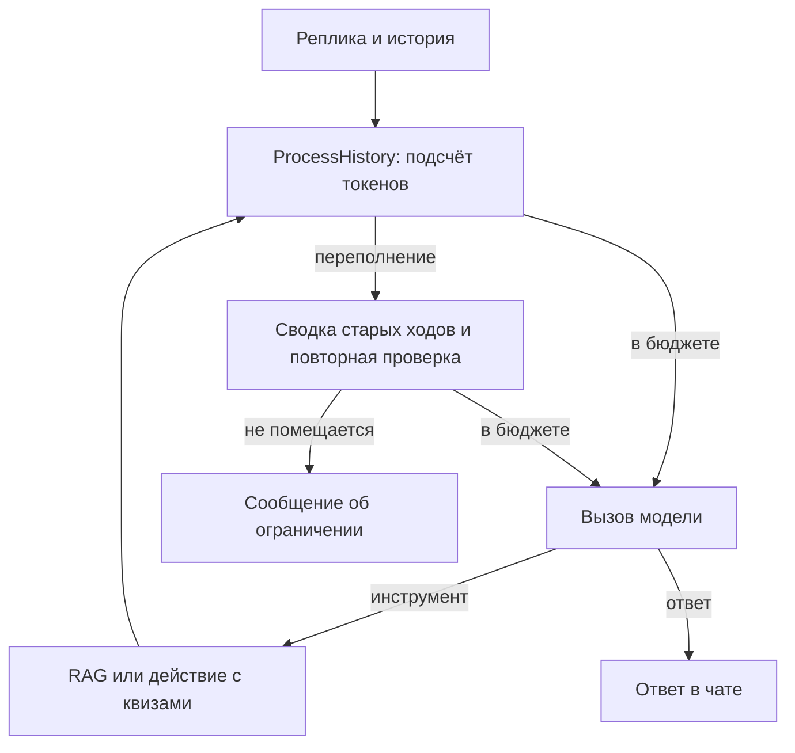

# Лаба 3. Сравнение агентов для веб-квизов по Python

Агент ищет материал в «Укусе Питона» и управляет квизами в локальном
веб-приложении. У обоих агентов одинаковы модель Ollama и четыре инструмента.
Готовый ToolCallingAgent использует штатную историю, PydanticAI применяет
свой бюджет входа и автоматическую сводку.

ProcessHistory вызывается перед каждым запросом. Токенизатор Qwen оценивает
размер сообщений с запасом на схему и сериализацию. Из 4096 токенов
512 отведены ответу, 256 оставлены запасом. При переполнении отдельный агент
PydanticAI получает старые сообщения в пределах собственного входного бюджета
и составляет сводку. Приложение сохраняет текущий ход и, если помещается,
предыдущий завершённый ход. Если сводка не помещается или вызов не удался,
старые ходы исключаются. Крупные результаты инструментов можно заменить
пометкой, сохранив пары вызов–результат. Если вход всё ещё слишком велик,
пользователь получает сообщение об ограничении и может продолжить чат.
Сокращение отражается в context-trim. Использование токенов сводки входит в
статистику агента.

Набор содержит 15 задач: шесть вопросов по учебнику, шесть коротких диалогов
с квизами и три длинных диалога. В последних нужно изменить первый из двух
квизов и использовать число из ранней реплики. Список квизов помогает найти
ID, а число должно остаться в истории или её сводке.

## Результаты

Реальный сравнительный прогон предстоит выполнить. После ручной разметки
перенесите таблицы из summary.csv и ссылки из report.md. Разберите минимум
пять неудачных задач каждого агента и минимум три категории ошибок.

По измерениям укажите, где агенты выигрывают, как изменилась точность
после сводки, сколько стоят дополнительные проценты качества в токенах
и секундах, какое решение повлияло на результат и что исправить первым.
Локальные тарифы API нулевые. Электричество и оборудование не измеряются.
