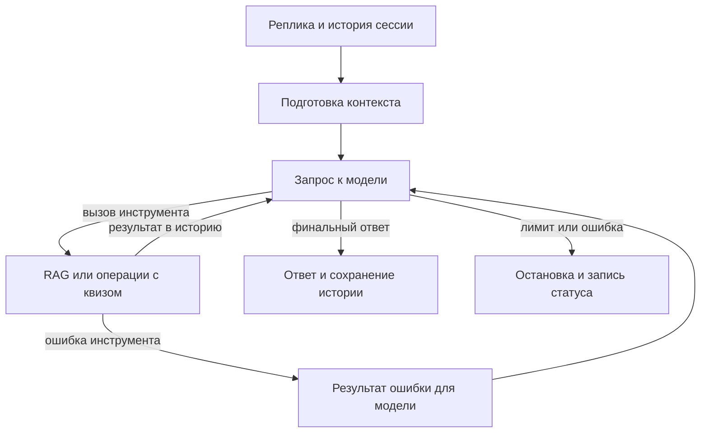

# Лаба 3. Сравнение диалоговых агентов для квизов по Python

**Артём Ковалёв.** Оба агента работают с учебником «Укус Питона» и управляют квизами. Сравнение выполнено на одной модели `qwen2.5:7b` через Ollama, одном индексе RAG из Лабы 2 и одинаковых задачах.

Этот отчёт описывает сохранённые прогоны до `lab3-quiz-v4` и разметки v2.
После исправления разметки и адаптеров метрики нужно получить заново; числа
ниже не являются результатами исправленной версии. Старые оценки не изменены.

## Пайплайн

Свой агент использует цикл Pydantic AI. У готового агента цикл и память ведёт `smolagents.ToolCallingAgent`. Оба используют общие функции `search_book`, `list_quizes`, `get_quiz_info` и `manage_quiz`. Последний создаёт и удаляет квизы, добавляет, заменяет и удаляет вопросы. Хранилище квизов работает на SQLite. Langfuse получает отдельный трейс на реплику, общий `session_id` на диалог и вложенные события модели, инструментов, поиска и сокращения. Готовый агент инструментирован через OpenInference и OpenTelemetry.

### Управление контекстом

У своего агента окно настроено на 12 288 токенов. Из него резервируются 1 024 под ответ и 256 под различия в сериализации. Перед ходом порог сокращения составляет 8 960 токенов, чтобы оставить ещё 2 048 под рост контекста при вызовах инструментов. Сначала `ClearToolResults` очищает старую выдачу поиска, сохраняя пары вызов–результат. Если этого мало, удаляются старые завершённые ходы целиком. Внутри хода бюджет проверяется перед запросом к модели, а при малом запасе инструменты отключаются. При превышении жёсткого входного предела в 11 008 токенов ход останавливается. Подсчёт токенизатором Qwen по сериализованным сообщениям является оценкой размера входа.

Лимиты своего агента составляют восемь шагов модели, четыре вызова инструментов и 120 секунд на реплику. У готового агента сохранена штатная история. Адаптер Ollama может преобразовать обычный текст модели в `final_answer`, поэтому статус завершения сам по себе не доказывает выполнение инструмента. Сравнение относится к двум конфигурациям целиком.

## Датасет и оценка

18 задач, 39 проверяемых реплик на агента. В наборе девять одиночных задач, шесть коротких диалогов и три длинных сценария по шесть реплик. Шесть задач лёгкие, семь средние и пять сложные. В длинных сценариях нужно вернуться к первому квизу и использовать число из ранней реплики. У реплик размечены критерии, ожидаемые инструменты, зависимость от истории и, где применимо, страницы PDF для оценки поиска.

Использованы два полных прогона с внешними бинарными оценками `external_judge`. Единица требовала выполнения критерия и успешных обязательных вызовов. Для записи в квизы также сверялись доступные снимки до и после. В `evaluate.py` успех диалога требует успеха каждой проверяемой реплики. `Tool correctness` показывает наличие ожидаемых имён инструментов. Корректность их аргументов и состояния квиза проверяется отдельно. Метрики поиска рассчитаны при `k=5` по размеченным страницам.

- [Прогон custom](http://localhost:3000/project/lab3/datasets/cmw43ib670006nx07cagwalkj/runs/09207228-0a5e-478a-b28f-e9e434dd752a)
- [Прогон smolagents](http://localhost:3000/project/lab3/datasets/cmw43ib670006nx07cagwalkj/runs/1b622103-5728-460a-9a6e-b92f5a799fed)

## Результаты

| Метрика | custom | smolagents |
|---|---:|---:|
| Успешные задачи | 22.2% | 0.0% |
| Учёт контекста | 13.3% | 0.0% |
| Контекст до первого сокращения | 22.2% | — |
| Контекст после первого сокращения | 0.0% | — |
| Средняя задержка задачи, с | 53.04 | 66.74 |
| Средние входные токены на задачу | 10458.67 | 12114.33 |
| Средние выходные токены на задачу | 526.89 | 822.61 |
| Средняя стоимость задачи, USD | 0.00 | 0.00 |
| Задачи с ошибкой | 5.6% | 16.7% |
| Задачи с превышением лимита шагов | 0.0% | 0.0% |
| Шаги на реплику | 2.03 | 1.77 |
| Вызовы инструментов на реплику | 1.00 | 0.69 |
| Максимальный контекст, оценка в токенах | 10737.00 | — |
| Tool correctness | 53.8% | 25.6% |
| Recall@5 | 0.63 | 0.47 |
| Precision@5 | 0.42 | 0.30 |
| MRR | 1.00 | 0.71 |

| Тип | Сложность | Задач | Успех custom | Успех smolagents | Задержка custom, с | Задержка smolagents, с |
|---|---|---:|---:|---:|---:|---:|
| Все | Лёгкие | 6 | 3/6 | 0/6 | 46.84 | 63.19 |
| Все | Средние | 7 | 1/7 | 0/7 | 49.18 | 87.31 |
| Все | Сложные | 5 | 0/5 | 0/5 | 65.87 | 42.21 |
| Одиночные | Все | 9 | 3/9 | 0/9 | 49.75 | 61.59 |
| Одиночные | Лёгкие | 6 | 3/6 | 0/6 | 46.84 | 63.19 |
| Одиночные | Средние | 1 | 0/1 | 0/1 | 71.12 | 61.29 |
| Одиночные | Сложные | 2 | 0/2 | 0/2 | 47.78 | 56.94 |
| Диалоги | Все | 9 | 1/9 | 0/9 | 56.33 | 71.89 |
| Диалоги | Средние | 6 | 1/6 | 0/6 | 45.53 | 91.64 |
| Диалоги | Сложные | 3 | 0/3 | 0/3 | 77.93 | 32.38 |

У `custom` прошли 4 из 18 задач и 8 из 39 реплик. У `smolagents` прошли 0 задач и 0 реплик. На проверках истории `custom` прошёл 2 из 15 реплик, `smolagents` — 0 из 15. У `custom` до первого зарегистрированного сокращения прошли 2 из 9 контекстных реплик, после — 0 из 6. Группы состоят из разных реплик. Эти числа показывают падение наблюдаемого качества, а причинный эффект сокращения потребовал бы повторного прогона тех же реплик с другим бюджетом.

## Разбор ошибок по трейсам

| Агент | Задача | Категория | Что произошло |
|---|---|---|---|
| custom | S03 | Неполный ответ | Пример показывает вложенность, но правило группировки команд по одинаковому уровню отступа не объяснено. [Трейс](http://localhost:3000/project/lab3/traces/8ba441f5b1cad749dfa0e15313bd5c23) |
| custom | S06 | Ошибка в примере | Вложенная функция с `global x` меняет имя модуля, а ответ ошибочно показывает изменение локального `x` внешней функции. [Трейс](http://localhost:3000/project/lab3/traces/36221be507aa35f18c3b5680950dca2b) |
| custom | S07 | Пропущен инструмент | Квиз создан, но обязательный контрольный вызов `get_quiz_info` отсутствует. [Трейс](http://localhost:3000/project/lab3/traces/ff13973f61ada1d42e2c2d33a55d552f) |
| custom | D01 | Неверное состояние квиза | Во втором вопросе четыре варианта вместо трёх, а ключ описывает `range(5)` как список. [Трейс](http://localhost:3000/project/lab3/traces/e79b6e90fea43b9b390c21693fb4bc7b) |
| custom | L03 | Ошибка учёта истории | Агент изменил второй квиз вместо первого и использовал 2 вместо 79. [Трейс](http://localhost:3000/project/lab3/traces/4b96dacc9dfa854235eff22d190bc69e). |
| smolagents | S01 | Пропущена ссылка на источник | Типы чисел названы, PDF-страница не указана. [Трейс](http://localhost:3000/project/lab3/traces/75c7d2edf3277a7084d54ebb3e19a154) |
| smolagents | S02 | Пропущена ссылка на источник | Агент назвал оба идентификатора и дал правило, но не указал страницу 47, присутствовавшую в выдаче. [Трейс](http://localhost:3000/project/lab3/traces/582978b910bcc9d70485e92f510f8641) |
| smolagents | S05 | Уход от темы | Поиск вызван, но итоговый ответ пересказывает материал про списки вместо объяснения `continue`. [Трейс](http://localhost:3000/project/lab3/traces/88f0863cde310d6adc3ee29b2b1ba23d) |
| smolagents | S07 | Пропущены инструменты | Поиск выполнен, квиз не создан и не прочитан. [Трейс](http://localhost:3000/project/lab3/traces/0afe7b9791c814a2ea161230e92100ba) |
| smolagents | D03 | Преждевременное завершение | После поиска агент пересказал материал про функции без успешного `manage_quiz`. [Трейс](http://localhost:3000/project/lab3/traces/db921336c2d44ed3231646557cc6f491) |

## Выводы

- `custom` чаще завершал требуемую цепочку инструментов и лучше отвечал на простые вопросы по учебнику. При этом на сложных задачах у обоих агентов успех нулевой. У `custom` встречаются нарушения формата квизов и неверная привязка к предыдущей реплике, у `smolagents` типичный сбой — остановка после поиска или текстовая имитация вызова.
- Прирост успеха у `custom` составил 22,2 процентного пункта. Средняя задача заняла на 13,70 секунды меньше и потребовала примерно на 1 951 токен меньше суммарно. В этом сравнении каждый дополнительный процентный пункт сопровождается экономией около 0,62 секунды и 88 токенов на задачу. Это отношение наблюдаемых разностей двух прогонов. Стоимость API у обоих нулевая по заданным тарифам, расходы на оборудование и электричество не измерялись.
- По трейсам больше всего на практический результат влияют завершение цепочки инструментов и сохранение точной ссылки на сущность из диалога. Вклад скользящего окна, лимитов и адаптера по отдельности эти прогоны не измеряют.
- Первое улучшение для `smolagents` — различать финальный ответ и напечатанный вызов инструмента. Для `custom` — проверять фактический результат правки и соответствие квиза ограничениям пользователя перед финальным ответом.
