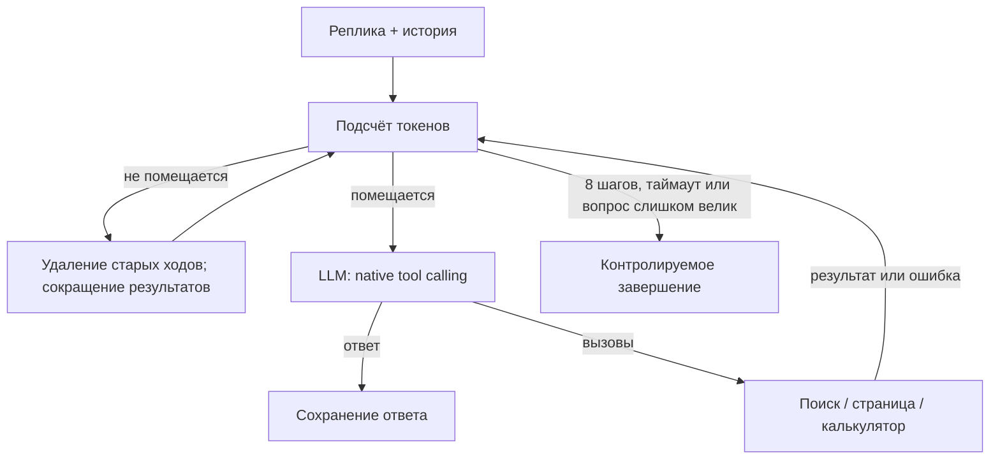

# Лаба 3. Диалоговые агенты по учебнику Python

## Задача и архитектура

Помощник проверяет учебные карточки по «Укусу Питона», находит первоисточник,
читает страницу и выполняет связанные расчёты. RAG импортирован из Лабы 2.

Каждая итерация и вызов инструмента вложены в трейс реплики; реплики объединены
session_id. Generation содержит запрос, ответ, параметры, usage и стоимость.
Поиск имеет отдельный вложенный retrieval-span с исходными чанками и scores.
События сокращения содержат удалённые сообщения и токены до/после.

Контекст считается токенизатором Qwen с chat template и схемами инструментов
перед каждым вызовом LLM. Из 4096 резервируются 512 токенов ответа и 256 на
различия сериализации HF/Ollama. Пока вход помещается в оставшийся бюджет,
передаётся вся история. Затем удаляются старейшие завершённые ходы целиком,
без разрыва пар tool_call/tool_result. Если не помещается текущий ход,
сокращаются тексты результатов его инструментов. Текущий вопрос не обрезается.
Вопрос, который сам не помещается в бюджет, получает явное сообщение об ограничении.

Выбор удаления старых ходов обусловлен простотой: не нужен дополнительный вызов
LLM для суммаризации и не возникает ошибок пересказа. Недостаток — забывание
ранних числовых параметров; длинные диалоги проверяют именно это. Полный архив
остаётся в Langfuse, но не подмешивается обратно в контекст модели.

Таймаут контролируется между шагами и перед инструментами; оставшееся время
передаётся HTTP-клиенту. Это не принудительное прерывание Python-процесса:
сетевые timeouts ограничивают операции ввода-вывода, не дают жёсткого real-time
дедлайна. Калькулятор допускает только ограниченные арифметические выражения.

## Датасет и сравнение

15 задач: 9 одиночных, 3 коротких диалога по 3 реплики и 3 длинных по 21 реплике.
Всего 81 реплика на агента, 162 на полный сравнительный прогон. Сложности:
3 easy, 9 medium, 3 hard. В каждом длинном диалоге только пользовательские
сообщения занимают 5701 токен Qwen, то есть уже больше лимита 4096 без ответов
и инструментов. Зависимости от истории и ожидаемые инструменты размечены
на уровне реплик; эталонные документы указаны через PDF-страницы.

Эталоны для тематических карточек взяты из вопросов Лабы 2. Поэтому это учебный
сравнительный набор, а не независимый тест обобщения на новые документы.

Готовый агент — неизменённый ToolCallingAgent из smolagents 1.22.0 с памятью
`reset=False` в пределах диалога. Инструменты подключены через его API Tool,
логирование — официальная OpenInference-интеграция. MCP и прокси не нужны.
Одинаковы модель, температура, предел ответа, максимальное число шагов,
предметные инструкции и инструменты. Системная оболочка готового агента,
его встроенный final_answer и стратегия памяти отличаются.
У модели окно 32768; собственный агент ограничивает контекст 4096,
готовый использует штатную память. Это сравнение двух систем с разными
стратегиями памяти, **не** доказательство превосходства при равных токенных бюджетах.

## Метрики и результаты

Реальных прогонов пока нет. Таблицу создаёт `source/evaluate.py` после
разметки `review.csv`; вместо отсутствующих измерений не ставятся нули.
Сводка содержит разбивку по типу и сложности, task success, context success,
контекст до/после сокращения, токены, стоимость, время, шаги, инструменты,
ошибки и retrieval-метрики. Полный диалог успешен, если успешны все его реплики.
Сравнивать эту метрику с успехом одиночных вопросов нужно с учётом длины диалога.

## Разбор ошибок

Заполняется после реального прогона: минимум 5 неудачных задач каждого агента,
не менее 3 выделенных по трейсам категорий. Для каждого случая указать задачу,
реплику, ссылку на трейс, наблюдаемый сбой и аргументированную причину.
Скрипт переносит категории и комментарии из review.csv в отчёт и сообщает,
если наблюдений недостаточно. Категории заранее не объявляются результатом.

## Выводы — заполнить по измерениям

1. На каких типах задач и сложностях выигрывает каждый агент? Какие действия
   в трейсе объясняют разницу?
2. Как различается context success до и после первого сокращения? Привести
   пример потерянного факта и токены из context-trim, учесть различие сложности.
3. Сколько токенов, секунд и USD расходуется на задачу и на успешную задачу?
   При приросте качества Δ процентных пунктов: дополнительная средняя стоимость
   / Δ и дополнительное среднее время / Δ. При Δ=0 отношение не определено.
4. Какие архитектурные решения видны в причинах ошибок? Без абляций не
   приписывать им доказанный причинный эффект.
5. Какое одно изменение исправит самую частую наблюдавшуюся ошибку?

Локальная API-стоимость равна нулю, но вычисления не бесплатны: время и токены
сравниваются отдельно, стоимость оборудования и энергии здесь не измеряется.
