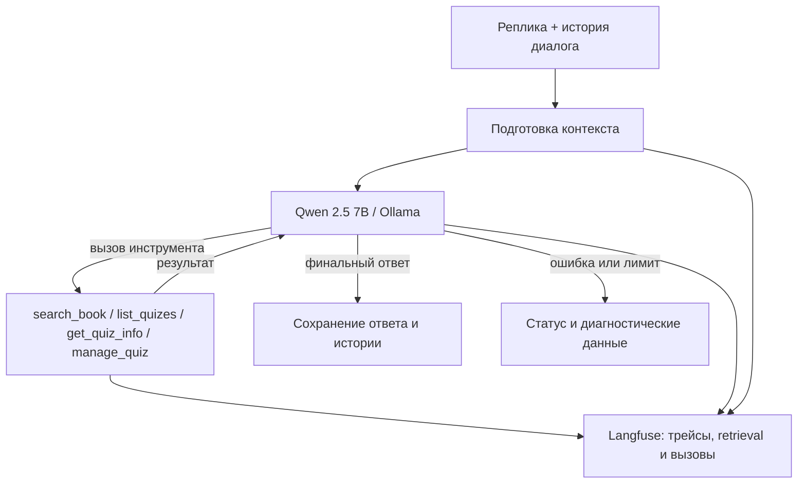

# Лаба 3. Сравнение диалоговых агентов для квизов по Python

**Артём Ковалёв.** Результаты эксперимента 6 ноября 2026 года. Сравниваются собственный агент на PydanticAI (`custom`) и готовый `smolagents.ToolCallingAgent` на одной модели `qwen2.5:7b` через Ollama. Общие источники — учебник «Укус Питона», RAG-индекс из Лабы 2 и SQLite-хранилище квизов.

> Примечание: ниже приведены **исторические измерения** двух агентов от 6 ноября
> 2026 года. В текущем коде после этих прогонов внедрены
> `TieredCompaction` (включая LLM-суммаризацию) и третий вариант
> `coding` на `smolagents.CodeAgent`. Новых сравнительных измерений для
> этих изменений пока нет.

## Архитектура и воспроизводимость



`custom` использует PydanticAI и собственную обработку истории. У него контекстное окно 12 288 токенов: резерв 1 024 на ответ и 256 на погрешность подсчёта, перед новым ходом дополнительно 2 048 на результаты инструментов; порог сокращения истории — 8 960 токенов. Сначала `ClearToolResults` сокращает старые результаты поиска, затем при необходимости удаляются целые старые ходы. Внутри хода выполняется только проверка бюджета, без повторной суммаризации. На реплику заданы максимум 8 шагов модели, 4 вызова инструментов и 120 секунд.

`smolagents` использует штатный цикл и память `ToolCallingAgent`, адаптер Ollama и интеграцию OpenInference/OpenTelemetry. Схемы инструментов в актуальной ветке формируются из аннотаций и docstrings Python-функций; для вложенного типа `Question` в smolagents предусмотрено сохранение Pydantic-схемы и проверок. Оба агента получают одну и ту же ограниченную выдачу RAG (не более 4 000 символов, с PDF-страницами); полные результаты поиска сохраняются в данных эксперимента.

Данные эксперимента: 18 задач и по 39 реплик на агента: 9 одиночных задач, 6 коротких диалогов и 3 длинных диалога по 6 реплик. По сложности: 6 лёгких, 7 средних, 5 сложных. Для контроля истории используются ссылки на ранее созданные квизы и числа, заданные в предыдущих репликах. Метрики RAG вычислены при `k=5` по эталонным PDF-страницам.

Прогоны:
- **custom:** `20261106T091347Z-f13a68` — [результаты в Langfuse](http://localhost:3000/project/lab3/traces/0606481f8a54b75e9893b6203b6769b7) (пример трейса S02).
- **smolagents:** `20261106T092905Z-775cec` — [результаты в Langfuse](http://localhost:3000/project/lab3/traces/e8124d7565d5ee38343f7465921a3fd2) (пример трейса S01).

Источник чисел: `summary.csv` из двух прогонов; примеры ошибок — их `report.md`. Использована импортированная бинарная оценка `external_judge`: 1 только при выполнении всех существенных условий реплики. `evaluate.py` дополнительно требует успешный статус реплики и выполнение обязательных инструментов и действий. **Успех задачи/диалога** означает успешность всех её проверяемых реплик. `Tool correctness` отражает ожидаемые имена инструментов, а не правильность аргументов или содержимого квиза; содержательные ошибки проверяются отдельно.

## Количественные результаты

| Метрика | custom | smolagents |
|---|---:|---:|
| Успешные задачи (18) | **4/18 (22,2%)** | **0/18 (0%)** |
| Учёт контекста (контекстные реплики) | 20,0% | 0,0% |
| Контекст до первого сокращения (custom) | 33,3% | — |
| Контекст после первого сокращения (custom) | 0,0% | — |
| Среднее время на задачу | **49,61 с** | 72,85 с |
| Средние входные токены на задачу* | 13 454,94 | 19 548,76 |
| Средние выходные токены на задачу* | 635,00 | 866,88 |
| Стоимость API на задачу** | $0,00 | $0,00 |
| Задачи с ошибкой | 11,1% | 50,0% |
| Задачи с достижением лимита шагов | 0,0% | 5,6% |
| Среднее число шагов на реплику* | 2,23 | 2,85 |
| Среднее число вызовов инструментов на реплику | 1,08 | 1,54 |
| Максимальный оценённый контекст, токенов | 11 536 | — |
| Tool correctness | 61,5% | **74,4%** |
| Recall@5 | 0,50 | **0,62** |
| Precision@5 | 0,35 | **0,41** |
| MRR | 0,82 | **0,96** |

* Для `smolagents` покрытие учёта токенов/стоимости составляет 94,4% задач против 100% у `custom`; средние токены и шаги следует интерпретировать с учётом пропусков. Величины из CSV агрегированы по задачам, а не являются скоростью отдельного запроса модели.

** Стоимость API равна нулю по заданным тарифам локальной модели; затраты на оборудование и электроэнергию не измерялись.

### Разбивка по сложности и типу

| Группа | Число задач | Успех custom | Успех smolagents | Время custom, с | Время smolagents, с |
|---|---:|---:|---:|---:|---:|
| Лёгкие | 6 | 3/6 | 0/6 | 35,32 | 50,83 |
| Средние | 7 | 1/7 | 0/7 | 49,21 | 73,97 |
| Сложные | 5 | 0/5 | 0/5 | 67,30 | 97,72 |
| Одиночные | 9 | 3/9 | 0/9 | 38,84 | 52,49 |
| Диалоги | 9 | 1/9 | 0/9 | 60,37 | 93,21 |
| Короткие диалоги (средние) | 6 | 1/6 | 0/6 | 49,46 | 73,10 |
| Длинные диалоги (сложные) | 3 | 0/3 | 0/3 | 82,21 | 133,44 |

По среднему времени `custom` быстрее на **23,25 с на задачу** (примерно на 31,9% относительно `smolagents`). Разница успешности — **22,2 процентного пункта**. Однако по Tool correctness и RAG-метрикам впереди `smolagents`: успешность конечной операции нельзя подменять фактом вызова нужного инструмента или наличия релевантного поиска.

## Анализ ошибок на конкретных трейcах

| Агент и сценарий | Категория | Наблюдение |
|---|---|---|
| custom / [S02](http://localhost:3000/project/lab3/traces/0606481f8a54b75e9893b6203b6769b7) | Ошибка ответа | Правило и страница 47 верны, но предложенный Python-пример содержит синтаксически недопустимое присваивание `2things = 10`. |
| custom / [S06](http://localhost:3000/project/lab3/traces/4be4ba82462e2df818266e74d559b716) | Ошибка исполнения | Ошибка модели HTTP 500, требуемый ответ о `global` не получен. |
| custom / [S07](http://localhost:3000/project/lab3/traces/79fda4624a76e7ee36678d93dff888a7) | Инструмент | Пропущено обязательное успешное чтение квиза через `get_quiz_info`. Аналогично S08 и S09. |
| custom / [D02](http://localhost:3000/project/lab3/traces/b7fd9027df1d781bb04106c8f4fe9736) | Состояние квиза | Созданы вопросы с четырьмя вариантами вместо трёх. |
| custom / [L01, ход 2](http://localhost:3000/project/lab3/traces/89f8ed5afa17952b657ff668d136b134) | Содержимое вопроса | Вопрос о длине строки ошибочно отмечает `sum()` вместо `len()`. |
| custom / [L02, ход 1](http://localhost:3000/project/lab3/traces/11ffd8f756467d50e0166ea87d21d7fb) | Контекст | Ссылка верна, но агент не воспроизводит сохранённое число 53. |
| smolagents / [S01](http://localhost:3000/project/lab3/traces/e8124d7565d5ee38343f7465921a3fd2) | Уход от задачи | Вместо объяснения числовых типов выводит проект JSON-квиза; нет требуемого примера и PDF-страницы. |
| smolagents / [S07](http://localhost:3000/project/lab3/traces/123c37ef25261fa62895fc0624a1a12f) | Инструмент | Отсутствует успешный `get_quiz_info`. |
| smolagents / [D01](http://localhost:3000/project/lab3/traces/bfb891cb6640591dc6fc1e41b1de4cca) | Неверная операция | Создан `Python Basics` вместо `Практика 1`, три вопроса вместо двух; предпринята попытка чтения несуществующего ID. |
| smolagents / [D03](http://localhost:3000/project/lab3/traces/928af0ce1db6ebe103449edd72b611bb) | Инструмент | Нет успешного `manage_quiz:create`. |
| smolagents / [L01, ход 1](http://localhost:3000/project/lab3/traces/8b17bed46ba21645a04a5d89f215f075) | Контекст | Агент не воспроизвёл число 37, хотя ссылка на квиз корректна. |
| smolagents / [L02, ход 1](http://localhost:3000/project/lab3/traces/22f641135290ffb5aa9562352238c001) | Контекст | `list_quizes` выполнен, ссылка корректна, но число 53 не воспроизведено. |

В исходном отчёте `smolagents` также отмечены ошибки формата ответов, пропуски создания квизов (S08, S09, D02, D05, D06) и потеря числа 79 в L03. Доля `error_rate=50,0%` не равна доле проваленных заданий (100%): некоторые неверные по критериям ответы завершились с техническим статусом `success`.

## Выводы и ограничения

1. `custom` успешно завершил 4 из 18 задач и оказался быстрее, несмотря на более низкие `Tool correctness` и оценки поиска. Это подчёркивает необходимость проверки итогового состояния квизов, а не только факта вызова инструмента.
2. `smolagents` чаще использовал ожидаемые инструменты и лучше находил релевантные фрагменты, но ни одна задача целиком не прошла оценку. Наблюдались неправильные операции с квизами, уход от пользовательского вопроса и ошибки памяти.
3. На сложных задачах обе конфигурации показали 0/5 успешных решений. У `custom` после зафиксированного сокращения истории в этой выборке успех контекстных реплик составил 0%; это **не доказывает причинное влияние** сокращения: группы до/после состоят из разных реплик.
4. Проверялись две конкретные конфигурации на одной малой локальной модели. Результат нельзя переносить на все реализации PydanticAI и smolagents. Статистическая значимость не оценивалась; для вывода о причинах нужны повторные прогоны/абляции. Сравнение отражает состояние кода и схем инструментов, с которым выполнены указанные прогоны.
5. Практические улучшения: для `custom` — проверять ограничения задания и правильность содержимого квиза перед подтверждением успеха; для `smolagents` — улучшать формирование структурированных вызовов и соблюдение инструкций. Повторные прогоны после изменения адаптера следует считать **отдельным экспериментом**, не смешивая метрики.

## Повторная оценка из сохранённых результатов

```powershell
uv run --locked python source/evaluate.py ".\results\20261106T091347Z-f13a68" --judge-score external_judge
uv run --locked python source/evaluate.py ".\results\20261106T092905Z-775cec" --judge-score external_judge
```

Оценки `external_judge` должны быть заранее привязаны к соответствующим `trace_id` в Langfuse. Файлы `summary.csv` и `report.md` каждого прогона являются исходной детализацией и не заменяются этим сводным отчётом.
