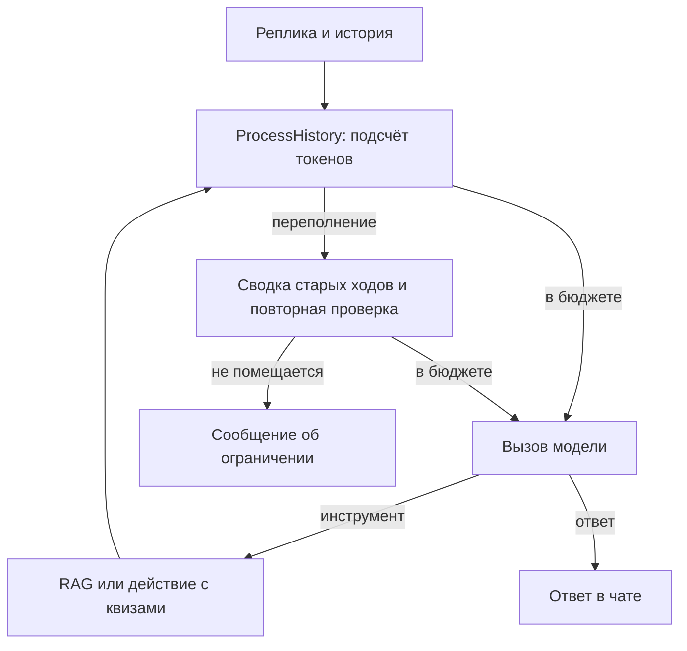

# Лаба 3. Сравнение агентов для веб-квизов по Python

Агент ищет материал в «Укусе Питона» и управляет квизами в локальном
веб-приложении. У обоих агентов одинаковы модель Ollama и четыре инструмента.
Готовый ToolCallingAgent использует штатную историю, PydanticAI применяет
свой бюджет входа и автоматическую сводку.

ProcessHistory проверяет бюджет перед каждым запросом. Из 4096 токенов
512 отведены ответу, 256 оставлены на различия в сериализации. Размер
оценивается токенизатором Qwen по сообщениям, инструкциям и схемам инструментов.

Сводку создаёт штатный SummarizingCompaction из Pydantic AI Harness. Он хранит
её в CompactionPart и учитывает вызов суммаризатора в общей статистике.
FallbackCompaction переключается на SlidingWindowCompaction при ошибке
суммаризатора. ToolOutputLimits ограничивает большой результат при получении,
а ClearToolResults служит запасным вариантом, когда текущий ход всё ещё велик.

Порог Harness запускает сокращение по оценке. Итог проверяется отдельно,
поскольку сохранённый хвост вместе со сводкой может превысить локальный
бюджет. Тогда остаётся последний полный ход, как в примере ProcessHistory.
Пользовательский запрос не обрезается. Если последний ход не помещается
даже после сокращения выдачи, пользователь получает сообщение об ограничении
и может продолжить чат. Токены до и после записываются в context-trim.

Набор содержит 15 задач: шесть вопросов по учебнику, шесть коротких диалогов
с квизами и три длинных диалога. В последних нужно изменить первый из двух
квизов и использовать число из ранней реплики. Список квизов помогает найти
ID, а число должно остаться в истории или её сводке.

## Результаты

Реальный сравнительный прогон предстоит выполнить. После ручной разметки
перенесите таблицы из summary.csv и ссылки из report.md. Разберите минимум
пять неудачных задач каждого агента и минимум три категории ошибок.

По измерениям укажите, где агенты выигрывают, как изменилась точность
после сводки, сколько стоят дополнительные проценты качества в токенах
и секундах, какое решение повлияло на результат и что исправить первым.
Локальные тарифы API нулевые. Электричество и оборудование не измеряются.
